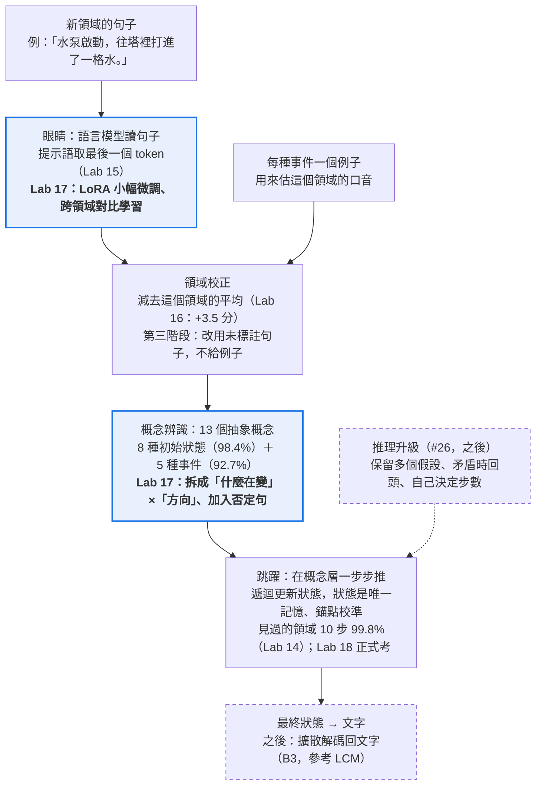
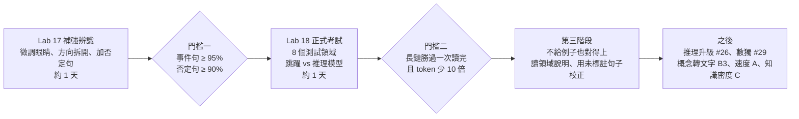
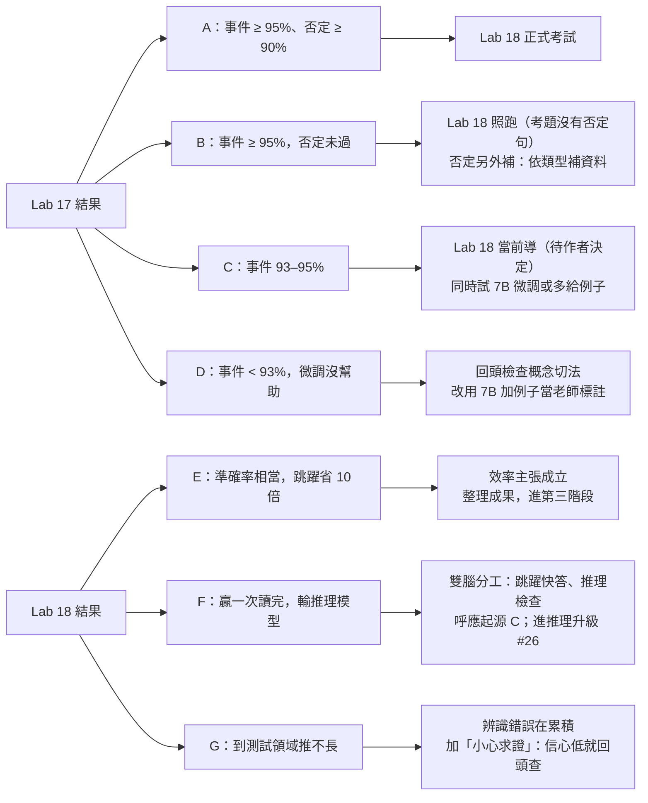

# 觸類旁通（B1）下一階段完整規劃

2026-11-01。追蹤於 [#30](https://github.com/EndeavorYen/LLM-learning/issues/30)；實驗登錄在 [#25](https://github.com/EndeavorYen/LLM-learning/issues/25)。

## 一、一頁摘要

**下一階段的目標**：
1. 讓新領域的單句辨識跨過 95%（長鏈要接近 99%）。
2. 到 8 個從未碰過的測試領域正式考試，讓「跳躍」和文字推理模型正面比較。

- **現在在哪**
  - 到了新領域，每種事件給一個例子，最好能認對 92.7%；初始狀態句 98.4%。
  - 剩下的錯誤集中在兩處：
    - 「進」和「出」的方向搞反，約佔四成；
    - 否定句，例如「水泵沒有打水」，幾乎全錯。
- **已經知道的**：在見過的領域，多步推理推到 10 步有 99.8%，一次讀完的模型只有 48%。卡關的是「看懂新領域的句子」，不是推理。
- **建議路線，分三段**：
  1. **補強辨識（Lab 17）**：目標 ≥ 95%。
     - 小幅微調「眼睛」（LoRA，只訓練模型裡一小部分參數）；
     - 把「方向」拆開學；
     - 訓練時放入否定與「別的系統」句子。
  2. **正式考試（Lab 18）**：在 8 個測試領域比三種做法——跳躍、一次讀完的模型、文字推理模型。比正確率、token 數與耗時。
  3. **往目標推進**：
     - 不給例子也能推，即第二階段的觸類旁通；
     - 「大膽假設、小心求證」的推理升級（#26）。
- **不做**：一直加領域硬撐。Lab 16 顯示領域數每加倍，只多 1.5 到 4 分。

## 二、到目前為止的證據

| 實驗 | 問題 | 結果 | 對下一步的意義 |
| --- | --- | --- | --- |
| Lab 11 | 跳躍學得會嗎？ | 先訓練漏斗並固定、再訓練跳躍，才學得會；聯合訓練會把錨點擠在一起 | 先固定辨識，再訓練推理 |
| Lab 12（v5） | 新領域的規律聯想 | 跳躍 85%，與一步分類器相當 | 第一句就決定答案的題目，多步沒有優勢 |
| Lab 13 | 64 維壓縮 vs 原始特徵 | 差距來自壓縮；64 維沒有比較穩 | 不必堅持 64 維 |
| Lab 14 | 依序推理能否推到更長 | 見過的領域只用 1–4 步訓練，推到 6–10 步 99.8%；一次讀完的模型 48%。新領域全部卡在辨識 | 多步推理成立，辨識是瓶頸 |
| Lab 15 | 哪種「眼睛」（把句子轉成數字的模型）加判斷方式最能認新領域 | 最好 83.7%；7B 不比 1.5B 好；否定句 7% | 眼睛變大沒用，讀法比大小重要 |
| Lab 16 | 給一個例子 / 加領域 | 給例子 92.7%（+3.5）；初始句 98.4%；24 個領域不給例子 88% | 例子的作用是「校正這個領域的口音」；剩下方向與否定兩個問題 |

**還沒做的**：
- 測試領域上的正式考試；
- 與文字推理模型比較；
- 速度（起源目標 A）；
- 概念轉文字（B3）；
- 知識密度（C）。

## 三、前人成果調研（SOTA）

前人成果支持我們的大方向：在概念層學、用遞迴推理。也為「看懂新領域」提供三個現成工具：
- 少量標註的對比微調；
- 用領域統計做校正；
- 用規則產生的否定資料。

### 看懂新領域（B1）可以借用的

| 前人成果 | 他們發現什麼 | 對我們的意義 |
| --- | --- | --- |
| [SetFit](https://arxiv.org/abs/2209.11055)（2022） | 用少量標註句子對比微調句向量模型，再接分類器。每類 8 句就接近全量微調，模型只有 15M–355M | 微調眼睛有現成配方，不必大量資料 |
| [PromptEOL](https://arxiv.org/abs/2307.16645) | 用「This sentence: "…" means in one word:」取最後一個 token 當句向量。用 QLoRA 對比微調後，2.7B 勝過 4.8B 的專用編碼器 | 我們的提示語取法就是這個；單卡可微調 |
| [Prototypical Networks](https://arxiv.org/abs/1703.05175)（2017） | 每類一個原型，新句子看離哪個近 | 即我們「找最像的例子」；Lab 16 顯示一個例子太少 |
| [AdaBN](https://ar5iv.arxiv.org/html/1603.04779)（2016） | 把模型裡的平均與變異換成新領域的，就能適應新領域，**不需要標註** | 「校正口音」就是這個思路；改用未標註句子，就是「不給例子」的第一步 |
| [Qwen3 Embedding](https://arxiv.org/abs/2506.05176v3)（2025-06） | 有 0.6B / 4B / 8B 三種；多階段訓練加合成資料與模型合併；多語 MTEB 領先 | 新的眼睛候選 |
| [否定分類法與基準](https://arxiv.org/abs/2507.22337)（2025） | 密集檢索與 LLM 嵌入遇到否定仍然差；依否定類型平衡訓練，收斂更快 | 否定是公認弱點 |
| [CANNOT](https://aclanthology.org/2023.inlg-main.12/)（2023） | 用規則自動產生否定句來微調，否定敏感度大增，其他能力不受影響 | 否定可以靠自動產生的對比資料修 |
| [LoRA](https://arxiv.org/abs/2106.09685)（2021） | 凍結原權重，只訓練低秩矩陣；可訓練參數少約一萬倍 | 微調工具 |

### 概念層思考與推理（B2、B3）

| 前人成果 | 他們發現什麼 | 對我們的意義 |
| --- | --- | --- |
| [Large Concept Models](https://ai.meta.com/research/publications/large-concept-models-language-modeling-in-a-sentence-representation-space/)（Meta，2024-12） | 一句話當一個「概念」，在 SONAR 句向量空間預測下一個概念，試了回歸、擴散、量化三種做法。從 1.6B 擴到 7B，多語零樣本勝過同尺寸 LLM | 和「先概念、再文字」同一個想法；B3 的主要對照 |
| [LLM-JEPA](https://arxiv.org/abs/2509.14252)（2025-09） | 在 LLM 加入「在嵌入空間預測」的訓練目標，明顯優於標準目標，較不易過擬合 | 支持「在概念空間學」 |
| [Coconut](https://arxiv.org/abs/2412.06769)（2024-12） | 隱藏狀態直接當下一步輸入（連續思考）。需回溯的題目 ProsQA 97.0% vs 文字推理 77.5%，思考 token 14 vs 49 | 和跳躍同類；可同時保留多個假設 |
| [The Illusion of State](https://arxiv.org/abs/2404.08819)（ICML 2024） | Transformer 與常見 SSM 的表達力在 TC⁰ 內，無法表達「排列組合」這類狀態追蹤 | 解釋 Lab 14 |
| [Entity Tracking in LMs](https://virtual2023.aclweb.org/paper_P3911.html)（ACL 2023） | 只有 GPT-3.5 能追蹤實體狀態，歸功程式碼預訓練；序列變長就下降 | 題目難度參考 |
| TRM / HRM（見 [`related_work_trm_hrm.md`](related_work_trm_hrm.md)） | 7M 的遞迴小網路反覆修正答案，數獨 87.4% | 「反覆修正」與「沿時間推」互補 |

### 第二步的對手與起源目標 A

| 前人成果 | 他們發現什麼 | 對我們的意義 |
| --- | --- | --- |
| [DeepSeek-R1](https://arxiv.org/abs/2501.12948v1)（2025-01） | 只靠強化學習就出現自我反思與驗證；推理能力可蒸餾給小模型 | 對手：R1 蒸餾小模型 |
| [Qwen3](https://arxiv.org/abs/2505.09388)（2025-05） | 一個模型兼具思考與不思考模式，可設思考預算；0.6B 到 235B | 對手：同量級 Qwen3 思考模式 |
| [LLaDA](https://arxiv.org/abs/2502.09992v2)（2025-02） | 8B 擴散語言模型，與自家自回歸基線相當 | 擴散做文字已可行 |
| [Mercury](https://arxiv.org/abs/2506.17298)（2025-06） | 商用擴散 LLM，H100 上每秒 1109 token，比速度優化模型快最多 10 倍 | 「變快」已有人驗證；我們暫緩 |

### 方向盤點：有價值、走不通、還沒人回答

**結論：大方向有價值，而且主流研究正朝同一個方向走。但原本的幾個具體做法已被證明走不通。我們真正的機會在一個窄而可驗證的位置。**

| 想法 | 前人現況 | 判斷 |
| --- | --- | --- |
| 先有概念、再轉文字 | Meta LCM 做到 7B。後續 [SONAR-LLM](https://airi.net/blog/SONAR-LLM)（2025-09）穩定勝過 LCM，但不總是勝過一般 LLM。自回歸 LCM 不穩，擴散版沒有速度優勢 | **有價值，未定論**。大廠在拚規模，我們不該跟 |
| 在概念／潛在空間一步步推理 | Coconut。[遞迴深度模型](https://arxiv.org/abs/2502.05171)：3.5B 反覆跑同一塊，推理達到約 50B 的算力水準，不需要思考鏈資料。TRM 只有 7M | **有價值，證據增加中**。Lab 14 與此一致 |
| 一次讀完的 Transformer 推不了長狀態鏈 | Illusion of State 證明了上限。但[思考鏈理論](https://arxiv.org/abs/2310.07923v3)證明：允許和輸入等長的中間步驟，就能做狀態追蹤 | **理論成立，但推理模型也做得到**。我們的價值只能是「便宜」 |
| 擴散取代逐字生成以求快（A） | LLaDA、Mercury | **大廠已證明可行**。不是我們的戰場 |
| 雙腦：快直覺加慢思考（C） | [Dualformer](https://arxiv.org/abs/2410.09918v3)：同一模型有快、慢、自動三種模式，迷宮的自動模式 96.6%，步驟少 59.9% | **有前人做法**。可把跳躍定位成「快模式」 |
| 提升知識密度 | [Densing Law](https://arxiv.org/html/2412.04315v2)：開源模型的「能力密度」約每 3.3 個月翻倍，主要靠資料與訓練 | **目標正確**。但原本的「9.56 倍」不成立，主張要在同資料、同算力下比 |
| 凍結句向量加小分類器就能跨領域 | Lab 15：84%。文獻：句向量對否定很弱；SetFit / PromptEOL 都需要微調 | **「凍結就夠」被否定**，要微調 |
| 64 維低維規律空間更穩、壓縮帶來泛化 | 我們自己的 Lab 13 / 14 否定了；LCM 也用 1024 維 | **走不通**，不再堅持 64 維 |
| 漏斗與跳躍一起訓練 | Lab 11：錨點被擠在一起 | **走不通**，改兩段式 |
| 靠加領域資料硬撐 | Lab 16：每加倍只多 1.5–4 分 | **低效**，不當主線 |
| 新領域給例子校正 | AdaBN、原型法、SetFit 都是成熟技術；Lab 16 +3.5 分 | **有效**。用未標註句子校正是合理的下一步 |

**沒人回答、我們可以回答的問題**：一個很小的概念層遞迴推理器，在「沒見過的領域」的狀態追蹤題上，能否用少幾個數量級的 token，達到同量級推理模型的正確率？前人各做了一塊：
- 概念模型不做推理長鏈；
- 潛在推理不做跨領域；
- 推理模型不省。

**建議**
1. **把主張改窄**：不說「新架構全面勝過 Transformer」，改說「小型概念層遞迴推理器的效率與跨領域能力」。這個主張可驗證、有理論支持，也還沒人做。
2. **第二步一定要和推理模型比**，並報「正確率對 token」的曲線。理論上它們也做得到，差別只在花費。
3. **直接借用成熟工具**：
   - 眼睛：用 SetFit / PromptEOL 式對比微調；
   - 否定：用 CANNOT 式自動產生的否定資料；
   - 不給例子：用 AdaBN 式的無標註校正。
4. **推理升級（#26）參考遞迴深度與 Coconut**：自己決定想幾步，在潛在空間同時保留多個假設。
5. **暫停**：
   - 堅持 64 維；
   - 沒有同條件對照的知識密度主張；
   - 速度目標 A，等概念管線打通再回來。

## 四、架構：目前與目標

藍色是 Lab 17 要改的部分，虛線是之後的階段，其餘已經有了，也驗證過。

## 五、路線圖

每一段的產出都是一份事先登錄的結果。過了門檻才進下一段；沒過的走法見第七節。第三階段就是作者說的「不給例子，也能從過往經驗推出來」。

## 六、每一階段的測試設計

照既有紀律執行：
- 事先登錄，程式經獨立審查；
- 固定資料 sha，跑 3 個 seed；
- 新資料先過盲測。

| 階段 | 問題 | 資料 | 比較對象 | 主要指標 | 通過門檻（提案） |
| --- | --- | --- | --- | --- | --- |
| **Lab 17 補強辨識** | 微調眼睛、拆開方向、加入難題句後，新領域事件句能到 95% 嗎？否定能認嗎？ | 28 個訓練領域，4 折、每折藏 7 個；原本 16 個領域的難題句，另為 12 個新領域補寫難題句 | Lab 16 最佳（給例子 92.7%）；同一個眼睛不微調 | 藏起來的「原本風格」領域，事件句五選一，給一個例子 | ≥ 95%；否定判為「沒變化」≥ 90%，且一般句下降 ≤ 1 分 |
| **Lab 18 正式考試** | 在 8 個從未碰過的測試領域，多步推理能推到 10 步嗎？比推理模型省多少？ | 狀態追蹤測試故事（長度 1–10）；每個測試領域另寫 5 句例子句，不出現在故事裡，先過盲測 | 跳躍；一次讀完的 Transformer；符號版上限；Qwen3 小模型（思考與不思考）；R1 蒸餾 1.5B；Qwen2.5-7B 直接答 | 最終狀態正確率（短 1–4、長 6–10）、每題 token 數、每題秒數 | 跳躍長鏈 ≥ 一次讀完 ＋10 分；與同量級推理模型比，正確率不低於它，且 token 少 10 倍以上 |
| **第三階段：不給例子** | 不給例子，靠領域說明或未標註的句子，能對上概念嗎？ | 同 Lab 17 的交叉驗證 | 給一個例子的版本 | 同 Lab 17 | 與給例子的版本差距 ≤ 2 分 |
| **推理升級（#26）** | 只看結果學、自己決定步數、保留多個假設、矛盾時回頭 | 狀態追蹤，加上需要回溯的新題型（如數獨，#29） | 現行跳躍；Coconut 式潛在推理 | 長鏈正確率、步數 | 到時先登錄 |

### Lab 17 的四個做法（每個都針對一個已知弱點）

1. **方向拆開**（便宜，針對「進」「出」搞反）：判斷分成兩步。
   - 先判斷「什麼在變」：數量、安全機制，或沒變。
   - 再判斷「往哪個方向」：加或減、壞掉或修好。
   - 只要加一個小判斷頭，特徵不變。
2. **微調眼睛**（LoRA，針對「眼睛本來就看不出差別」）：
   - 用 Qwen2.5-1.5B 與 Qwen3-Embedding-0.6B。
   - 用提示語取最後一個 token，做跨領域對比學習：同一種事件、不同領域的句子拉近。
   - 每一折只用該折的訓練領域。
3. **加入難題句**（針對否定與「別的系統」）：
   - 訓練時放入訓練領域的否定、別的系統、倒敘句。
   - Lab 15 已看到，在別的領域學過否定，換到新領域也認得：沒微調就有 97%。
4. **組合**：以上三項，加上領域校正與一個例子。

設計是「方向拆開 × 微調 × 難題句」各開或關，共 8 組。每組都量「給一個例子」與「不給例子」兩種情況，就能看出哪個做法真的有用。

### Lab 18 的公平原則

- **資訊一致**：每個對手拿到同樣的資訊，包括領域規則、同樣的 5 句例子、整篇故事。
- **同一個辨識器**：跳躍和一次讀完的模型共用，差距只來自推理。
- **花費在同一張 L4 上量**：推理模型記錄產生的 token 數，跳躍記錄等效參數與耗時。

### 第三階段：學會「對應的方式」（作者構想，2026-11-01，見 #27）

目標不只是學概念，而是學會「把未知領域對應到已知概念」的手法。這比概念高一層，研究上叫「學會學習」（meta-learning）或類比對應。

三個候選做法都不給例子，比較對象是「給一個例子」的版本：
1. **模擬新領域來訓練**：每一回合都假裝遇到沒見過的領域，讓模型反覆練「對應」這個動作，把現在手寫的「校正口音」變成學出來的。
2. **用句子之間的關係來對應**：找出哪兩句意思相反（進與出）、哪句提到保護裝置（壞掉與修好）。看的是結構，而不是字面。
3. **先讀說明書**：用每個領域的規則句推出對應，再判斷每一句。

**附帶分析：領域的「重疊度」**
- **作者假說**：加領域越加越慢，是因為新領域和舊領域重疊，而不是正交。
- **量法**：算新領域句子的特徵有多少落在舊領域涵蓋的空間之外（投影殘差），再看殘差能不能預測「加入它能帶來多少進步」。
- **用途**：只挑「最有新意」的領域來加，不必盲目堆資料。

## 七、可能狀況與對應下一步

七種結果都有事先寫好的下一步，不會因為看到結果才改規則。F 最有意思：跳躍快但不夠準，正好對應起源的「雙腦」想法，也就是快的直覺配上慢的檢查。

## 八、風險、成本與時程

| 風險 | 會怎樣 | 對策 |
| --- | --- | --- |
| 微調後過度記住訓練領域 | 交叉驗證很高，到測試領域大跌 | 只在藏起來的領域量；測試領域到 Lab 18 才第一次使用 |
| 新寫的 12 個領域比較好認 | 成績偏樂觀（Lab 16：79.6% vs 86.5%） | 門檻只看「原本風格」的領域 |
| 否定句資料太少 | 只學到特定寫法 | 依否定類型平衡補寫；參考 CANNOT 的自動產生法 |
| 測試領域的例子句太特別 | 給例子的效果不穩 | 每個測試領域寫 2–3 組例子，輪流使用並報平均 |
| 推理模型跑得慢 | 1440 題 × 上千 token，在 Colab 上會花很久 | 用 vLLM 批次生成；必要時先登錄抽樣 480 題 |
| Colab 串流卡住 | 紀錄遺失 | 已改成同時寫入 VM 上的紀錄檔，Lab 16 已驗證可用 |
| 門檻設太高卡住進度 | 95% 一直差一點 | 事先寫好「未達 95% 時怎麼走」（見第七節） |

| 工作 | 內容 | 估計時間（兩台 Colab L4） |
| --- | --- | --- |
| Lab 17 資料 | 為 12 個新領域補寫 144 句難題句 ＋ 盲測 | 約半天 |
| Lab 17 執行 | 約 48 次 LoRA 訓練，每次數分鐘 | 約 2–3 小時 |
| Lab 18 資料 | 8 個測試領域，每組 5 句例子，共 2–3 組 ＋ 盲測 | 約半天 |
| Lab 18 執行 | 跳躍與對照組，加上 4–5 個推理模型 | 約 3–4 小時 |
| 第三階段與推理升級 | 視前兩步結果而定 | 之後再估 |

## 九、需要作者決定的事

括號內是建議。
1. **門檻怎麼算**：只看「原本風格」的領域（建議，因為新寫的領域偏容易），還是 28 個領域一起算？
2. **未達 95% 時**：停在 B1 繼續補強，還是達到 93% 就先跑 Lab 18 當前導？
   - 建議後者。跳躍與一次讀完的模型共用辨識器，比較仍公平，還能看出辨識錯誤在長鏈中怎麼累積。
3. **微調哪些眼睛**：Qwen2.5-1.5B 加 Qwen3-Embedding-0.6B（建議，便宜），還是也做 7B 的 QLoRA（約貴 3 倍）？
4. **第二步的推理模型對手**：
   - 建議：Qwen3-1.7B（思考與不思考）、R1 蒸餾 1.5B，再加較強的 Qwen3-8B 思考模式當參考；
   - 是否也加入商用 API 模型？
5. **測試領域的例子句**：另寫新句子、不出現在故事裡（建議），還是直接從故事用的句子裡挑？

## 十、參考資料

**本專案**
- [#25 B1 登錄與結果](https://github.com/EndeavorYen/LLM-learning/issues/25)
- [#26 推理升級](https://github.com/EndeavorYen/LLM-learning/issues/26)
- [#27 作者的想法紀錄](https://github.com/EndeavorYen/LLM-learning/issues/27)
- [#28 盲點清單](https://github.com/EndeavorYen/LLM-learning/issues/28)
- [Lab 15 結果](../results/recognition_v1/README.md)
- [Lab 16 結果](../results/recognition_v2/README.md)

**前人成果**（每一篇都打開過摘要頁）
- [SetFit](https://arxiv.org/abs/2209.11055) · [PromptEOL](https://arxiv.org/abs/2307.16645) · [Prototypical Networks](https://arxiv.org/abs/1703.05175) · [AdaBN](https://ar5iv.arxiv.org/html/1603.04779) · [Qwen3 Embedding](https://arxiv.org/abs/2506.05176v3) · [LoRA](https://arxiv.org/abs/2106.09685)
- [否定分類法](https://arxiv.org/abs/2507.22337) · [CANNOT](https://aclanthology.org/2023.inlg-main.12/)
- [Large Concept Models](https://ai.meta.com/research/publications/large-concept-models-language-modeling-in-a-sentence-representation-space/) · [SONAR-LLM](https://airi.net/blog/SONAR-LLM) · [LCM 綜述](https://arxiv.org/html/2501.05487v1) · [LLM-JEPA](https://arxiv.org/abs/2509.14252)
- [Coconut](https://arxiv.org/abs/2412.06769) · [遞迴深度模型](https://arxiv.org/abs/2502.05171) · [The Illusion of State](https://arxiv.org/abs/2404.08819) · [思考鏈的表達力](https://arxiv.org/abs/2310.07923v3) · [線性 RNN 的負特徵值](https://arxiv.org/html/2411.12537v5) · [Entity Tracking](https://virtual2023.aclweb.org/paper_P3911.html)
- [DeepSeek-R1](https://arxiv.org/abs/2501.12948v1) · [Qwen3](https://arxiv.org/abs/2505.09388) · [Dualformer](https://arxiv.org/abs/2410.09918v3) · [Densing Law](https://arxiv.org/html/2412.04315v2)
- [LLaDA](https://arxiv.org/abs/2502.09992v2) · [Mercury](https://arxiv.org/abs/2506.17298)
