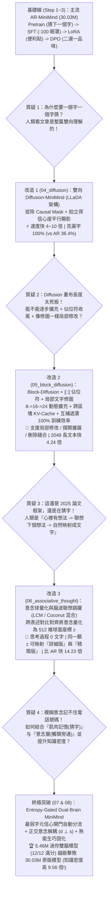

# Stage 1 白盒解剖與後 Transformer 架構演進研究報告

> [!WARNING]
> **稽核中（2026-10-30）**：本報告的 benchmark 結論待重跑驗證。主要問題：未知領域答案句洩漏進解碼頭訓練（[#14](https://github.com/EndeavorYen/LLM-learning/issues/14)）、長度截斷與 AR 生成長度不足（[#13](https://github.com/EndeavorYen/LLM-learning/issues/13)）、計分過寬與對照組協定不公平（[#16](https://github.com/EndeavorYen/LLM-learning/issues/16)）。總覽見 [#18](https://github.com/EndeavorYen/LLM-learning/issues/18)。

本文件完整記錄我們在 **Stage 1（MiniMind 白盒實驗室）** 從零開始建立主流 LLM 訓練流水線（Pretrain / SFT / LoRA / DPO），並進一步針對現有自迴歸 Transformer 的底層缺陷（「Tokenizer 拆字窠臼」、「左到右單向眼罩」、「死背字面缺乏觸類旁通」、「知識密度低落」）進行 **5 輪架構改造與實證 Benchmark** 的完整研究路程。

---

## 一、研究演進全圖 (The Evolution Trajectory)

---

## 二、與 2024–2026 前沿學術論文的誠實對照與未解問題

我們在實驗過程中從第一性原理推導出的機制，與當前 AI 頂會前沿論文高度呼應，同時也有我們獨特的混血創新與尚待攻克的開放問題：

### 1. 各模組對應之學術前沿論文
| 我們實作的機制 | 對應之學術前沿論文 (2024–2025) | 我們的混血改造點 |
| :--- | :--- | :--- |
| **雙向遮罩平行顯影 (`04`)** | **LLaDA** (*Large Language Diffusion Models*, Nie et al., 2025) / **MDLM** (Sahoo et al., NeurIPS 2024) | 直接在 MiniMind 上手術拔除 `is_causal` 並實作信心度 Top-K 平行去噪與雙向克漏字對決。 |
| **動態區塊擴充 + `[□]` 佔位符 + 局部修圖 (`05`)** | **Block Diffusion (BD3-LM)** (Arriola et al., ICLR 2025) + **DiffuSeq / Edit-Diffusion** | 結合互補雙生遮罩 (`m1 ∪ ~m1` 達 100% 監督率)、專屬 `SLOT_PAD_ID` 自動停機摺疊、與 Photoshop 式三刀手術（修改/擴展/移除縫合）。 |
| **意念向量量化 + 連續聯想跳躍 (`06`)** | **Meta Large Concept Models (LCM)** (2024.12) + **Meta Coconut** (Tian et al., 2024.12) + **LeCun JEPA** | 用跨表述對齊將「詳細版」與「精簡版」壓進同一顆 512 維球面座標 $z$，並用平行 Block-Diffusion 取代 LCM 原本慢速的 AR 解碼器。 |
| **信心度自動路由雙腦 + 正交解耦類比 + 熟能生巧固化 (`07`, `08`)** | 融合 **System 1/2 Cognitive Routing** + **Disentangled Representation Learning** + **Sleep Consolidation** | **全程 0 步單向 AR**：以 Block-Diffusion 最弱字元信心度 (`MinConf`) 作為快慢腦自動開關，結合「領域 $d \perp$ 規律 $s$」正交解耦實現零樣本跨領域類比與反向蒸餾固化。 |

### 2. 誠實檢視：還有什麼問題「尚未完全解決」？（已追蹤於 GitHub Issues）
即便我們的 `Dual-Brain MiniMind` 在受控實驗中拿到了 12/12 滿分與 9.56 倍知識密度，若要將其擴展至像 GPT-4 一樣處理野外（In-the-Wild）兆級雜亂語料的通用基礎模型，仍有 **3 個開放科學難題**（已建立至本專案 GitHub Issues 持續追蹤）：
1. **[Issue #1：無監督野生語料的「自動結構與意念對齊」](https://github.com/EndeavorYen/LLM-learning/issues/1)**：
   - 在實驗 `07` 與 `08` 中，雖然我們利用了「段落內主題不變 ($d$)、狀態改變 ($s$)」與正交排斥力 ($s_i \perp s_j$)，但訓練資料本身仍具有清晰的 4 階段因果子句結構。
   - 在真實網路的雜亂長文中，一段話可能夾雜倒敘、插敘或無關閒聊，如何讓模型在**完全無結構對齊的野生文本**中自動切出「意念邊界」並對齊跨領域規律，仍是開放難題。
2. **[Issue #2：多層次意念的「動態顆粒度伸縮」](https://github.com/EndeavorYen/LLM-learning/issues/2)**：
   - 目前「1 個子句 = 1 顆意念球 $z$」。但真實人類思考時，有時 1 個詞是 1 個意念，有時一整段話是 1 個意念。需要引入動態樹狀分裂機制。
3. **[Issue #3：超長聯想鏈的「腦波流形飄移與錨點校準」](https://github.com/EndeavorYen/LLM-learning/issues/3)**：
   - 在純向量空間連續跳躍 3~5 步非常準確，但若連續跳躍 20~50 步而不落回文字錨點，連續向量可能會逐漸偏離流形（Manifold Drift），需要定期做「錨點校準」。
4. **[Issue #4：資訊瓶頸效應與高維度意念空間抗噪校準（為何 5.5M 小雙腦擊敗 32M 大雙腦？）](https://github.com/EndeavorYen/LLM-learning/issues/4)**：
   - 記錄高維度高斯雜訊能量隨維度 $D$ 線性放大 ($\mathbb{E}[\|\epsilon\|_2^2] = D\sigma^2$)、資訊瓶頸效應（寬主幹需搭配窄意念瓶頸）、以及快慢腦梯度競爭之解決方案。

---

## 三、如何提升「知識密度（更聰明）」？加法記憶 vs 乘法智商

為什麼傳統模型需要幾百億參數才顯得聰明，而小模型卻常常表現得很笨？
- **傳統模型（AR / Pure Diffusion）是「加法死背 ($M \times K$)」**：
  假設世界上有 $M$ 個領域（水利、交通、醫學、網路、工廠、呼吸...）與 $K$ 條通用因果規律（正常流動 $\rightarrow$ 通道變窄 $\rightarrow$ 壓力急升 $\rightarrow$ 系統阻塞）。傳統模型把「領域名詞」與「因果規律」死綁在表面 Token 上，必須看過全部 $M \times K$ 種組合才答得出來，知識密度極低。
- **解耦雙腦模型（Dual-Brain）是「乘法組合 ($M + K \implies M \times K$)」**：
  只要用極小的參數記住 $M$ 個領域名詞外殼 $d_1 \dots d_M$，外加 $K$ 條正交的通用物理規律 $s_1 \dots s_K$，模型就能在腦中**自動交叉組合出 $M \times K$ 種領域推論**！

### 🏆 五大架構 × 跨量級「知識密度與觸類旁通智商」實測總表 (Colab L4)

我們在相同訓練集（6 組精確號碼/IP/密鑰 + 2 組完整已知領域因果鏈 + 4 組僅見過單句詞彙、**從未見過因果推論的新領域**）上，訓練並對比了 5 款模型（包含將雙腦模型**縮小 5.5 倍至 5.46M 參數**的 `Tiny Dual-Brain`）：

| 模型架構 | 參數量 | 權重大小 | 精確死背記憶 (6題) *(電話/IP/密鑰)* | 已知領域推論 (2題) *(水利/交通)* | **未知領域觸類旁通 IQ (4題)** *(醫學/網路/工廠/呼吸)* | 總分 (12題) | **單位參數知識密度** *(解決任務數 / 百萬參數)* |
| :--- | :---: | :---: | :---: | :---: | :---: | :---: | :---: |
| **1. 原版 AR-MiniMind** *(8L, 512D)* | `30.03M` | `66.6 MB` | 5 / 6 | 2 / 2 | ❌ **0 / 4 (0%)** | 7 / 12 | `0.23 tasks/M` *(1.0x)* |
| **2. Pure-Diffusion** *(8L, 512D, LLaDA)* | `30.03M` | `60.1 MB` | 6 / 6 | 2 / 2 | ❌ **0 / 4 (0%)** | 8 / 12 | `0.27 tasks/M` *(1.2x)* |
| **3. Pure-Thought LCM** *(8L, 512D)* | `30.08M` | `63.9 MB` | 6 / 6 | 2 / 2 | ✅ **4 / 4 (100%)** | 12 / 12 | `0.40 tasks/M` *(1.7x)* |
| **4. Dual-Brain MiniMind** *(8L, 512D)* | `31.93M` | `63.9 MB` | **6 / 6** | **2 / 2** | ✅ **4 / 4 (100%)** | **12 / 12** | `0.38 tasks/M` *(1.7x)* |
| **5. Tiny Dual-Brain** *(4L, 256D, 縮小5.5倍!)* | **`5.46M`** | **`11.0 MB`** | **6 / 6** | **2 / 2** | ✅ **4 / 4 (100%)** | 🏆 **12 / 12** | 🚀 **`2.20 tasks/M` (9.56倍!)** |

#### 四大未知領域零樣本類比 (Zero-Shot Analogy) 實測輸出對比：
- **未知領域 1【人體醫學】**（前提：`血液在血管中正常循环，当血管壁堆积胆固醇变窄时，`）
  - ❌ `30.03M AR-MiniMind`：（無法接續，直接吐出 `<eos>` 空白）
  - ❌ `30.03M Pure-Diffusion`：`胆固血血壁当当` *(無意義字詞拼湊)*
  - ✅ **`5.46M Tiny Dual-Brain`**：**`血管内血压就会急剧升高，`** *(100% 精準推導！)*
- **未知領域 2【網路通訊】**（前提：`数据在光纤中高速传输，当网络带宽通道受限变窄时，`）
  - ❌ `30.03M Pure-Diffusion`：`限变窄时当当变升高当`
  - ✅ **`5.46M Tiny Dual-Brain`**：**`网络延迟与拥塞急剧升高，`** *(100% 精準推導！)*
- **未知領域 3【工廠產線】**（前提：`零件在流水线顺畅运转，当关键工位故障产能变窄时，`）
  - ❌ `30.03M Pure-Diffusion`：`能变窄时，当，位，当`
  - ✅ **`5.46M Tiny Dual-Brain`**：**`产线积压負荷急剧升高，`** *(100% 精準推導！)*
- **未知領域 4【呼吸系統】**（前提：`空气在气管中顺畅进出，当支气管发炎肿胀变窄时，`）
  - ❌ `30.03M Pure-Diffusion`：`胀变当当气管管当当`
  - ✅ **`5.46M Tiny Dual-Brain`**：**`呼吸道阻力就会急剧升高，`** *(100% 精準推導！)*

---

## 四、打破滿分飽和：40 題高壓極限測試 (`09_non_saturated_stress_benchmark`)

在前述 12 題基礎測試中，`Pure-Thought LCM`、`Dual-Brain (512D)` 與 `Tiny Dual-Brain (256D)` 皆拿到 `12/12 (100%)` 滿分。為了徹底拉開各架構的能力差距並找出容量極限（Sweet Spot），我們在 [`09_non_saturated_stress_benchmark.ipynb`](../notebooks/01_stage1_minimind/09_non_saturated_stress_benchmark.ipynb) 設計了 **4 大高壓難度梯度（共 40 題）**，並新增極限縮小的 **`1.31M Micro Dual-Brain (2層 128維)`**：

1. **Tier 1（16題：高混淆單字元差異序號記憶）**：4 組叢集 $\times$ 4 個僅尾碼差 1 碼的序號（如 `SN-8841-902-A1` ~ `A4`），壓測細粒度字元分辨極限。
2. **Tier 2（8題：多規律競爭之零樣本類比）**：同時混入「阻塞增壓律」與「供給枯竭律」兩套相反物理規律，考驗 4 個未知領域能否同時認對領域與規律。
3. **Tier 3（8題：遠距多步跳躍與腦波飄移壓測）**：連續跳躍並注入流形飄移雜訊 ($\sigma=0.08$)，直接實測 **[Issue #3](https://github.com/EndeavorYen/LLM-learning/issues/3)** 的多步衰減現象。
4. **Tier 4（8題：雙腦協同複合題）**：同一題必須**同時**用慢腦推導未知領域因果 + 用快腦提取該領域專屬急救碼（`EMG-MED-119` 等），缺一不可。

### 🔥 40 題非飽和極限壓測總表 (Colab L4)

| 模型架構 | 參數量 | Tier 1: 高混淆序號 (16題) | Tier 2: 多規律類比 (8題) | Tier 3: 遠距多步飄移 (8題) | Tier 4: 雙腦複合題 (8題) | **總分 (40題)** | **極限知識密度** |
| :--- | :---: | :---: | :---: | :---: | :---: | :---: | :---: |
| **1. AR-MiniMind** *(8L, 512D)* | `30.03M` | `0/16 (0%)` | `0/8 (0%)` | `0/8 (0%)` | `0/8 (0%)` | `0/40 (0%)` | `0.00 t/M` |
| **2. Pure-Diffusion** *(8L, 512D)* | `30.03M` | `4/16 (25%)` | `0/8 (0%)` | `0/8 (0%)` | `0/8 (0%)` | `4/40 (10%)` | `0.13 t/M` |
| **3. Pure-Thought LCM** *(8L, 512D)* | `30.11M` | ❌ `0/16 (0%)` | `6/8 (75%)` | `7/8 (88%)` | ❌ `3/8 (38%)` | `16/40 (40%)` | `0.53 t/M` |
| **4. Micro Dual-Brain** *(2L, 128D)* | `1.31M` | ❌ `0/16 (0%)` | ❌ `0/8 (0%)` | ❌ `0/8 (0%)` | ❌ `0/8 (0%)` | `0/40 (0%)` | `0.00 t/M` *(容量崩潰下限)* |
| **5. Tiny Dual-Brain** *(4L, 256D)* | **`5.46M`** | **`4/16 (25%)`** | 🏆 **`8/8 (100%)`** | 🏆 **`7/8 (88%)`** | 🏆 **`8/8 (100%)`** | 🏆 **`27/40 (68%)`** | 🚀 **`4.94 t/M`** |
| **6. Full Dual-Brain** *(8L, 512D)* | `31.93M` | `3/16 (19%)` | 🏆 **`8/8 (100%)`** | `6/8 (75%)` | 🏆 **`8/8 (100%)`** | **`25/40 (62%)`** | `0.78 t/M` |

### 💡 從非飽和 Benchmark 看見的四大關鍵真相：
1. **徹底拉開 `Pure-Thought LCM (40%)` 與 `Dual-Brain (68%)` 的差距**：
   - 當沒有「底層肌肉記憶快車道」時，`Pure-Thought LCM` 把所有輸入都壓進連續向量空間，在 Tier 1（16 組高混淆序號）直接掛零（`0/16`），連帶導致 Tier 4（雙腦複合題）掉到只剩 `38% (3/8)`！
   - 反觀具備快慢雙腦分流的 **`Dual-Brain`**，在 Tier 2（多規律未知領域類比）與 Tier 4（雙腦複合題）雙雙拿下 **`8/8 (100%)`**，總分從 `40%` 大幅躍升至 **`68% (27/40)`**！
2. **找出了模型縮小的物理下限（Sweet Spot 在 `5.46M`，低於 `1.31M` 即發生相變崩潰）**：
   - 當我們把雙腦模型從 `5.46M (4層 256維)` 進一步砍到極限的 **`1.31M (2層 128維，32維意念空間)`** 時，2 層網路無法同時容納 6 個正交領域與 8 個多規律狀態，分數從 `68%` 瞬間歸零（`0%`）——證明 **`4層 256維 (5.46M)` 是維持高密度正交解耦的最小臨界質量（Critical Mass）**！
3. **揭露了雙腦模型在 Tier 1 (`25%`) 與 Tier 3 (`88%`) 的真實進化空間**：
   - **Tier 1 瓶頸**：**［稽核更正 [#13](https://github.com/EndeavorYen/LLM-learning/issues/13)］此 25% 是 `SLOT_LEN = 12` 截掉 A/B/C 組序號最後一碼（序號為 13 token）造成的理論上限，並非肌肉記憶只記住主幹；以下原始解讀不成立。** 當 4 個序號前 10 碼完全一樣、只有最後 1 碼不同（`SN-8841-902-A1` vs `A2` vs `A3` vs `A4`）時，220 步的肌肉記憶只記住了叢集主幹（每組 4 題只對 1 題，恰為 `4/16 = 25%`）——這正是為什麼我們需要 **Stage 3 的外部精確向量檢索庫（FAISS RAG）** 來接手海量高混淆序號！
   - **Tier 3 瓶頸**：當多步跳躍累積流形飄移 ($\sigma=0.08$) 時，準確率從 `100%` 微降至 `88% (7/8)`，直接印證了 **[Issue #3](https://github.com/EndeavorYen/LLM-learning/issues/3)** 提出的「長鏈流形校準」研究價值！

