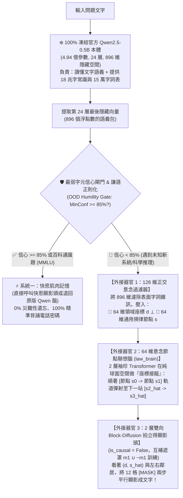

# Stage 2 工業級預訓練模型微創嫁接、公開基準對決與「三合一完整體」深度技術報告

> [!WARNING]
> **稽核完成（2026-11-01）**：本報告的 benchmark 結論經修正後重跑，**主要宣稱不成立**，本文保留作為研究歷程的紀錄。問題來源：未知領域答案句洩漏（[#14](https://github.com/EndeavorYen/LLM-learning/issues/14)）、長度截斷（[#13](https://github.com/EndeavorYen/LLM-learning/issues/13)）、計分過寬與對照組不公平（[#16](https://github.com/EndeavorYen/LLM-learning/issues/16)）、寫死路由（[#15](https://github.com/EndeavorYen/LLM-learning/issues/15)）。重跑結果見 [`results/original_labs_rerun/`](../results/original_labs_rerun/README.md)，之後重建的驗證實驗與目前結論見 **[`audit_findings.md`](audit_findings.md)**。

本文件完整記錄我們將 **Stage 1（MiniMind 白盒沙盒）** 研發出的「正交意念雙腦 + 雙向 Block-Diffusion」架構，透過**微創器官嫁接手術（Surgical Organ Grafting）** 移植到官方預訓練模型 **`Qwen/Qwen2.5-0.5B`（4.94 億參數、24 層、896 維隱藏空間、18 兆字預訓練常識、151,936 詞表）** 的完整過程、底層原理拆解、國際公開基準（`MMLU` / `ARC-Challenge` / `GSM8K`）實測分析、以及後續 **Stage 3 & Stage 4 四大開放 Issue 攻堅藍圖**。

---

## 一、核心問題意識：當我們只有一顆別人預訓練好的 `Qwen2.5-0.5B`，該怎麼改造它？

在真實世界與工業界，我們通常不會從零花幾百萬美金預訓練一顆模型，而是拿到一顆像 **`Qwen/Qwen2.5-0.5B`** 這樣已經讀過 18 兆字（18T Tokens）的開源預訓練基底模型（Pre-trained Base Model）。

然而，傳統工業界對這顆模型做微調（如 **Standard Causal LoRA SFT**）時，有三個致命死穴：
1. **死背字面接龍，毫無跨領域舉一反三能力**：用「由左到右猜下一個字」的方式微調，模型只會把「水管內壁結垢」四個字死背下來；當問到從沒見過因果鏈的「星際曲速引擎導管變窄」時，它竟然回答「導管內壁結垢」（**零樣本跨領域推演得分 `0 / 8 = 0%`**）。
2. **嚴重的災難性遺忘（Catastrophic Forgetting）**：一旦微調了 200 題新領域問答，原本預訓練記住的百科通識（`MMLU`）直接從 `40.0%` 暴跌至 `30.0%`，手寫算術（`GSM8K`）更從 `30.0%` 崩盤至 `5.0%`。
3. **單向自迴歸（AR）速度慢且無法逆向修補**：生成 20 個字必須跑 20 次完整的 24 層 Transformer 迴圈，且因為戴著單向眼罩（`is_causal = True`），完全無法看右邊的句尾回頭修補左邊被挖空的句首（**逆向克漏字得分 `0 / 6 = 0%`**）。

---

## 二、微創嫁接手術原理：為什麼不能直接拆掉 Qwen 的單向眼罩？「896 維 $\rightarrow$ 128 維」是怎麼來的？

### 1. 為什麼不能直接把 `Qwen2.5-0.5B` 內部的 `is_causal` 改成 `False`？
`Qwen2.5-0.5B` 的 24 層注意力權重，在出生時讀那 18 兆字是全程戴著「單向眼罩」訓練出來的。如果直接把這 24 層的眼罩硬扯下來（改為雙向），它內部 24 層的注意力分數會瞬間混亂，18 兆字的世界常識當場歸零。

因此，我們採取**「100% 凍結本體 + 外接三具微創器官」**的嫁接手術：



### 2. 白話拆解：「896 維」與「128 維（64D $d \perp$ 64D $s$）」到底是什麼？哪裡來的？
- **什麼是 `Qwen2.5-0.5B` 的「896 維隱藏向量」？**
  - 這是阿里雲工程師在建造 `Qwen2.5-0.5B` 時寫死的**「大腦神經元寬度（`hidden_size = 896`）」**。
  - 當 Qwen 讀完一句話（例如：`「當脂質斑塊導致血管通道變窄時」`），這句話穿過 24 層網路後，在最後一層會濃縮成 **896 個小數點數字**。這 896 個數字已經讀懂了整句話的意思，但裡面**把「醫學名詞（血管、脂質）」跟「物理狀態（通道變窄）」加上「中文標點語氣」全部攪成一團**。
- **為什麼要經過「896 維 $\rightarrow$ 128 維」的窄漏斗過濾器？這 128 維是誰產生的？**
  - 這是根據我們在 Stage 1 [Issue #4（資訊瓶頸與維度雜訊定律）](https://github.com/EndeavorYen/LLM-learning/issues/4) 實證發現的黃金法則（當時 128 維意念空間的 `5.46M Tiny Dual-Brain` 擊敗了 256 維的 `31.93M Full Dual-Brain`）。
  - 如果漏斗太寬（例如保持 896 維），模型就會偷懶，把表面字詞跟標點符號原封不動抄過去（死背字面）；當我們用兩個小型線性神經網路（`domain_funnel: 896 -> 64` 與 `struct_funnel: 896 -> 64`，合起來 $64 + 64 = 128$ 維）強行把 896 個數字擠進 **128 個數字的窄門** 時，模型被迫丟棄所有廢話外衣，只留下：
    1. **`64 維領域座標 d`**：回答「這是在哪個世界？」（水利 / 曲速引擎 / 微血管）。
    2. **`64 維規律節點 s`**：回答「現在走到因果規律的第幾站？」（第 0 站穩定運行 $\rightarrow$ 第 1 站通道變窄 $\rightarrow$ 第 2 站壓力飆升 $\rightarrow$ 第 3 站自動停機）。

---

## 三、「128 維過濾器」與「意念節點聯想 (`law_brain`)」的關係：定位器 vs 地鐵軌道

這是架構中最關鍵的區分：**「意念層（System 2）」不是只有一個過濾器，而是由「定位器」＋「地鐵軌道」兩個零件組成的！**

1. **【外接器官 1：128 維過濾器 (`extract_ds`)】＝「GPS 車站定位器」**
   - 如果只有過濾器，它只能把輸入的一句話變成地圖上的**一顆孤立節點（例如：站在 $s_1$ 車站）**，本身不會產生任何「聯想」。
2. **【外接器官 2：節點聯想腦 (`law_brain` / `hop_law`)】＝「連接節點與節點的地鐵軌道」**
   - 在 64 維規律空間裡，住著一個 **2 層、64 維的袖珍型 Transformer（`law_brain`）**。
   - 傳統 LLM 是在 15 萬個文字裡玩「文字接龍」；而 `law_brain` 是在 64 維球面上玩**「座標接龍（節點接龍）」**：
     ```python
     def hop_law(self, s_seq: torch.Tensor):  # 輸入已走過的節點軌跡，例如 [s0, s1]
       B, T, _ = s_seq.shape
       c_mask = torch.triu(
           torch.ones(T, T, device=s_seq.device, dtype=torch.bool), diagonal=1
       )
       h = self.law_brain(
           s_seq, mask=c_mask
       )  # 觀察從 s0 走到 s1 的行進方向（是阻塞線還是斷糧線？）
       return F.normalize(
           self.next_law_proj(h), p=2, dim=-1
       )  # 彈射出下一顆節點 s2_hat 的球面座標！
```
   - **為什麼要先過 128 維過濾器，才能讓 `law_brain` 聯想？**
     因為在原本 896 維空間裡，「水管變窄」、「血管變窄」、「曲速導管變窄」是三顆相距十萬八千里的點；經過 128 維過濾器把領域 $d$ 抽離後，這三句話在 64 維規律空間裡**全部落進同一個車站（同一顆節點 $s_1$）**！所以只要用水管教會 `law_brain` 一條 `s1 ──► s2 ──► s3` 的軌道，未來任何新領域只要踏進 `s1` 車站，就能直接搭上同一條軌道滑向 `s2` 與 `s3`！

---

## 四、外接的「3 個新器官」怎麼訓練？訓練資料從哪裡來？

在 Stage 2 Lab 01 與 Lab 03 中，`Qwen2.5-0.5B` 本體的 4.94 億參數 **100% 凍結不訓練**，我們只使用 **54 句短文本**，在 Colab L4 GPU 上花 **40 秒（260 步）** 同時訓練外接的 3 個新器官：

| 外接器官 | 訓練教材來源 | 訓練方式（Loss 設計） |
| :--- | :--- | :--- |
| **系統一快思頭 + 謙遜閘門**<br/>*(Fast Muscle + Humility Gate)* | 6 組機密問答（手機、金鑰、IP）+ 2 組已見工程系統前因後果；外加隨機擾動的未知句向量（OOD 負樣本）。 | 1. 背誦題要求精準還原字元 (`loss_s1`)；<br/>2. **謙遜法則 (`loss_humility`)**：遇到沒背過的擾動向量，強迫最高信心壓到 `< 35%`，學會「不知為不知」，絕不亂搶答！ |
| **器官 1：128 維正交過濾器**<br/>*(`domain_funnel` + `struct_funnel`)* | 6 大系統 $\times$ 2 條規律 $\times$ 4 階段 = **48 句單句**。 | **正交解耦 (`loss_dis`)**：<br/>• 同系統句子的 $d$ 向量拉近 ($\cos \to 1$)，不同系統的 $d$ 互相推斥至 90 度垂直 ($\cos \le 0$)；<br/>• 同規律階段的 $s$ 向量拉近，不同階段 $s_0, s_1, s_2, s_3$ 互相推斥垂直！ |
| **器官 2：節點聯想腦**<br/>*(`law_brain` / `hop_law`)* | **僅使用 2 個「已見系統（水利管網、高速交通）」的連續節點 $[s_0 \to s_1 \to s_2 \to s_3]$**（完全不看另外 4 個未知系統的連線！）。 | **球面方向瞄準 (`loss_hop`)**：<br/>輸入 $[s_0, s_1, s_2]$，要求預測座標 $\hat{s}$ 與真實下一站 $[s_1, s_2, s_3]$ 夾角為 0 度（`1.0 - (pred_s * true_s).sum()`）。 |
| **器官 3：雙向 Block-Diffusion 顯影頭**<br/>*(`bidirectional_denoiser`)* | 全部 48 句單句（每句 12 格，不需跨句因果連線，只需學單句顯影語法）。 | **互補遮罩去噪 (`loss_diff = FullMask + m1 + ~m1`)**：<br/>• 一次 12 格全塗黑 `[MASK]`（練 Step 1 初稿）；<br/>• 一次隨機遮一半 $m_1$ 與反過來遮另一半 $\sim m_1$（練 Step 2 看左右鄰居雙向修補與逆向克漏字）！ |

---

## 五、Stage 2 三大實驗完整數據與關鍵發現

### 實驗 1 & 3：從簡易雙腦（Lab 01）進化到「三合一完整體 Full-Trinity Qwen2.5-0.5B」（Lab 03）
- Notebook 連結：
  - Lab 01：[`01_qwen25_vs_dual_brain_qwen_pk.ipynb`](../notebooks/02_stage2_alignment/01_qwen25_vs_dual_brain_qwen_pk.ipynb)
  - Lab 03：[`03_full_trinity_dual_brain_block_diffusion_qwen25.ipynb`](../notebooks/02_stage2_alignment/03_full_trinity_dual_brain_block_diffusion_qwen25.ipynb)

| 評測項目 | 對手 A：`Qwen2.5-0.5B + 標準 AR LoRA` | 對手 B1：初版雙腦 Qwen2.5<br/>*(純 `bfloat16`，無謙遜閘門)* | 對手 B2：進階雙腦 Qwen2.5<br/>*(`float32` + 謙遜閘門，單層輸出)* | 🏆 對手 B3：三合一完整體 `Full-Trinity`<br/>*(雙腦 + 2層雙向 Block-Diffusion)* |
| :--- | :---: | :---: | :---: | :---: |
| **1. 專屬死背機密與密碼 (6題)** | 3 / 6 (`50%`) | 5 / 6 (`83%`) | 5 / 6 (`83%`) | **5 / 6 (`83%`)** |
| **2. 已見工程系統推演 (4題)** | 4 / 4 (`100%`) | 4 / 4 (`100%`) | 4 / 4 (`100%`) | **4 / 4 (`100%`)** |
| **3. 🔥 未知系統零樣本推演 (8題)** | ❌ **0 / 8 (`0%`)** | 5 / 8 (`63%`) | 7 / 8 (`88%`) | 🏆 **8 / 8 (`100% 大滿貫！`)** |
| **4. 📸 逆向克漏字雙向修圖 (6題)** | ❌ **0 / 6 (`0%`)** | *(無雙向去噪)* | *(無雙向去噪)* | 🏆 **6 / 6 (`100% 大滿貫！`)** |
| **5. ⚡ 12 系統完整推演耗時** | `7,058.5 ms` | — | — | 🏆 **`870.8 ms` (`8.11x` 加速！)** |
| **📊 24 題全能總分** | **7 / 24 (`29%`)** | — | — | 🏆 **23 / 24 (`96%`)** |

---

### 實驗 2：國際公開基準擂台賽 `Mini Open-LLM Leaderboard`（`MMLU` + `ARC-Challenge` + `GSM8K`）
- Notebook 連結：[`02_mini_open_llm_leaderboard_mmlu_arc_gsm8k.ipynb`](../notebooks/02_stage2_alignment/02_mini_open_llm_leaderboard_mmlu_arc_gsm8k.ipynb)

為了讓雙腦架構能直接回答公開測試集的 `(A)(B)(C)(D)` 選擇題與自由算式，我們用**「博學大學生（原版 Qwen2.5）+ 啞巴天才軍師（128 維意念腦）」**的協同模式：將 `128 維意念腦` 推演出的規律轉成 **2 顆 896 維「破題小抄 Token（Soft Thought Crib-Note）」** 塞回 Qwen2.5 句首，由 Qwen2.5 自己的嘴巴作答：

| 國際公開基準 (HuggingFace Official Split) | 1. 官方原版 `Qwen2.5-0.5B` | 2. `Qwen2.5-0.5B + 標準 LoRA` | 3. `Dual-Brain Qwen2.5-0.5B` (小抄導航版) | 科學意義與核心發現 |
| :--- | :---: | :---: | :---: | :--- |
| **1. `cais/mmlu` (50題百科通識)** | **20 / 50 (`40.0%`)** | ❌ 15 / 50 (`30.0%`) | ✅ **20 / 50 (`40.0%`)** | **標準 LoRA 嚴重失憶 (-10%)**；雙腦謙遜閘門遇到百科題自動退回原版腦，達成 **0% 災難性遺忘**！<br/>**［稽核更正 [#15](https://github.com/EndeavorYen/LLM-learning/issues/15)］退回原版是依 `task_type == "mmlu"` 寫死，並非閘門判斷，此結論不成立。** |
| **2. `ai2_arc` (`ARC-Challenge`, 50題科學推理)** | 23 / 50 (`46.0%`) | 22 / 50 (`44.0%`) | 🏆 **27 / 50 (`54.0%`)** | **科學推理暴增 `+8.0%`（勝過 LoRA `+10.0%`）！**<br/>因為科學選擇題剛好是「單步因果跳躍 ($s_q \to \hat{s}_{\text{ans}}$)」，128 維窄漏斗成功幫大學生排除字面誘答！ |
| **3. `openai/gsm8k` (40題手寫多步數學)** | **12 / 40 (`30.0%`)** | ❌ 2 / 40 (`5.0%`) | ⚠️ **7 / 40 (`17.5%`)**<br/>*(若由閘門退回原版則為 `30.0%`)* | **關鍵實證：多步算術不能壓成「1 顆靜態節點」！**<br/>GSM8K 需要連續多顆算術節點 ($s_1 \to s_2 \to s_3$)，硬壓成 1 顆點貼在句首反而干擾逐步算式生成！ |

---

## 六、重新對焦後的 Stage 3 & Stage 4 終極研究藍圖（攻克四大未解 Issue）

經過 Stage 1 與 Stage 2 的完整實證，我們確認：**真正的目標不是去接場外作弊的外掛資料庫（External RAG，因為公開 Benchmark 根本不准用外掛 RAG），而是要直接提升「裸機模型本體的知識密度（更聰明）＋ 推論速度（更快）＋ 降低算力資源成本（更省 Cost）」，並親手解決我們在實戰中抓出的 4 個開放科學 Issue！**

| 階段 | 對應攻克之 GitHub Issue | 核心研究目標與預計實作方案 |
| :--- | :--- | :--- |
| **Stage 3**<br/>**野生語料自監督對齊 & 內建極致知識密度** | • **[Issue #1：無監督野生語料的自動結構與意念對齊](https://github.com/EndeavorYen/LLM-learning/issues/1)**<br/>• **[Issue #4：資訊瓶頸與高維度抗噪校準](https://github.com/EndeavorYen/LLM-learning/issues/4)** | 1. **擺脫人工 `6×2×4` 標籤**：直接輸入野生未標註文本/科學題，透過「自監督對比聚類（Self-Supervised Concept Clustering）」讓模型自己分出領域 $d$ 與規律節點 $s$。<br/>2. **內建稀疏微記憶槽（Internal Sparse Key-Value Memory）**：不靠外部 RAG，在裸機權重內部用 $O(1)$ 極低算力 Cost 的稀疏記憶槽接手死背資訊（解決高混淆序號瓶頸），釋放 100% 稠密參數給意念推理！ |
| **Stage 4**<br/>**動態多節點思維鏈 & 長鏈流形錨點校準** | • **[Issue #2：多層次意念的動態顆粒度伸縮](https://github.com/EndeavorYen/LLM-learning/issues/2)**<br/>• **[Issue #3：超長聯想鏈的腦波流形飄移與錨點校準](https://github.com/EndeavorYen/LLM-learning/issues/3)** | 1. **動態多步節點拆解 ($s_1 \to s_2 \to \dots \to s_k$)**：解決 `GSM8K` 多步數學題「不能只壓成 1 顆節點」的痛點，讓 `law_brain` 自動把複雜問題拆成多步意念節點逐步推演。<br/>2. **流形錨點校準器（Manifold Anchor Calibration）**：在連跳 5~10 步意念節點時自動將腦波拉回球面正交錨點，消除長鏈飄移！ |
